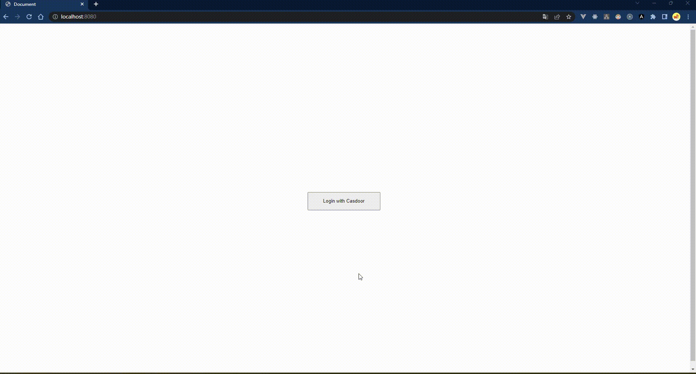

# Casdoor Raw JS Example

[](https://github.com/casdoor/casdoor-raw-js-example/actions/workflows/build.yml)
[](https://github.com/casdoor/casdoor-raw-js-example/blob/master/LICENSE)
[](https://discord.gg/5rPsrAzK7S)

An example of signing in with [Casdoor](https://casdoor.ai/) in plain JavaScript: one HTML page without a framework or a build step, and a small Node.js backend.

| Part     | File                     | SDK                                                                 |
|----------|--------------------------|---------------------------------------------------------------------|
| Frontend | [index.html](index.html) | [casdoor-js-sdk](https://github.com/casdoor/casdoor-js-sdk), loaded from a CDN |
| Backend  | [server.js](server.js)   | [casdoor-nodejs-sdk](https://github.com/casdoor/casdoor-nodejs-sdk) |



## How it works

1. **Login with Casdoor** sends the user to the Casdoor sign-in page (`sdk.getSigninUrl()`); the random `state` in the URL is kept in sessionStorage.
2. After signing in, Casdoor redirects back to `http://localhost:5000/callback` with `code` and `state`.
3. The page checks the state and sends the code to the backend (`sdk.signin()`): `POST /api/signin?code=...&state=...`.
4. The backend exchanges the code for an access token (`sdk.getAuthToken()`) and returns it; the page keeps it in sessionStorage.
5. The page reads the user from `GET /api/getUserInfo` with `Authorization: Bearer <token>`; the backend verifies the token, a JWT, with the certificate (`sdk.parseJwtToken()`).

## Prerequisites

- Node.js 18+
- A Casdoor server. The example is preconfigured for the public demo server https://door.casdoor.com, so it runs as is. To use your own, see [Casdoor installation](https://casdoor.ai/docs/basic/server-installation).

## Configuration

Skip this section to try the example with the public demo server.

In your Casdoor, create (or reuse) an organization and an application, and add `http://localhost:5000/callback` to the application's **Redirect URLs**. Then fill in both parts:

[index.html](index.html):

```js
const sdk = new SDK({
  serverUrl: "https://door.casdoor.com", // Casdoor server URL
  clientId: "294b09fbc17f95daf2fe", // client ID of the application
  appName: "app-vue-python-example", // name of the application
  organizationName: "casbin", // organization of the application
  redirectPath: "/callback",
  signinPath: "/api/signin",
})
```

[server.js](server.js):

```js
const authCfg = {
  endpoint: 'https://door.casdoor.com', // Casdoor server URL
  clientId: '294b09fbc17f95daf2fe', // client ID of the application
  clientSecret: 'dd8982f7046ccba1bbd7851d5c1ece4e52bf039d', // client secret of the application
  certificate: cert, // the certificate of the cert used by the application, see Casdoor -> Certs
  orgName: 'casbin', // organization of the application
  appName: 'app-vue-python-example', // name of the application
};
```

## Run

```shell
git clone https://github.com/casdoor/casdoor-raw-js-example
cd casdoor-raw-js-example
npm install
npm start
```

Open http://localhost:5000 and click **Login with Casdoor**. On the demo server, sign in with username `admin` and password `123`.

To use another port: `PORT=3000 npm start`, and use that port in the Redirect URLs.

## Resources

- [Casdoor documentation](https://casdoor.ai/docs/overview)
- [casdoor-js-sdk](https://github.com/casdoor/casdoor-js-sdk)
- [casdoor-nodejs-sdk](https://github.com/casdoor/casdoor-nodejs-sdk)

## License

[Apache-2.0](LICENSE)
